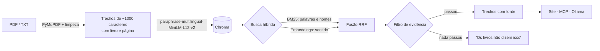

# Marginália — RAG de clássicos em português

**Pergunte aos livros. Receba só o que está escrito.**

Um sistema RAG (*Retrieval-Augmented Generation*) sobre clássicos da literatura em língua
portuguesa, com uma regra central: **toda resposta precisa de evidência no texto**. Cada
resultado é um trecho original com livro e página; quando nada nos livros sustenta a
pergunta, o sistema diz isso em vez de inventar.

O projeto tem três formas de uso, todas sobre o mesmo índice:

| Interface | Para quê | Precisa de |
|---|---|---|
| **Site** (`docs/`) | Buscar no navegador, com citações e mapa de onde o assunto aparece em cada livro | Nada — roda 100% no navegador, publicável no GitHub Pages |
| **Servidor MCP** (`mcp_server.py`) | Um assistente de IA (Claude Code, Claude Desktop…) consulta os livros e responde citando as fontes | Python |
| **Modo local** (`perguntar_local.py`) | Perguntas e respostas offline com um LLM local | [Ollama](https://ollama.com) |

## Acervo

| Ano | Livro | Autor |
|---|---|---|
| 1865 | Iracema | José de Alencar |
| 1878 | O Primo Basílio *(trecho)* | Eça de Queirós |
| 1881 | Memórias Póstumas de Brás Cubas | Machado de Assis |
| 1890 | O Cortiço | Aluísio Azevedo |
| 1899 | Dom Casmurro | Machado de Assis |

Todos em domínio público.

## Arquitetura



**Por que não alucina**

1. **Trechos, não resumos** — o que chega ao usuário (ou ao LLM) é sempre o texto original, com livro e página.
2. **Busca híbrida** — BM25 encontra nomes e frases exatas (“olhos de ressaca”); embeddings encontram paráfrases (“como ele morreu?”). As duas listas são fundidas por *Reciprocal Rank Fusion*.
3. **Filtro de evidência** — um trecho só é aceito se for semanticamente próximo da pergunta (distância de cosseno ≤ 0,45) ou se contiver os termos dela. Os limiares foram calibrados: perguntas sobre os livros ficaram com distância ≤ 0,38; perguntas fora do tema, ≥ 0,54.
4. **Instruções ao modelo** — via MCP ou Ollama, o LLM recebe a ordem de responder só com os trechos, citar `[Fonte N]` e dizer “não encontrei” quando o contexto não basta.

Resultado da avaliação (`python avaliar_busca.py`): **14/14** perguntas com o livro certo em 1º lugar e **6/6** perguntas fora do tema recusadas.

## Como rodar

Testado com **Python 3.12**. Evite versões muito novas do Python: o `onnxruntime`
(dependência do Chroma) demora a ganhar suporte a elas — no 3.15 a instalação falha.

```bash
python -m venv .venv
source .venv/bin/activate          # Windows: .venv\Scripts\activate
pip install -r requirements.txt
```

### 1. Indexar os livros

Coloque os `.pdf` ou `.txt` em `livros/` (ou aponte outra pasta com `RAG_LIVROS_DIR`) e rode:

```bash
python ingest.py            # indexa (pula livros já indexados)
python ingest.py --reset    # apaga o índice e refaz tudo
```

Dica: nomes como `01 - Título.pdf` viram a ordem na série. Na primeira execução o modelo de
embedding (~470 MB) é baixado.

### 2. Testar a busca

```bash
python busca.py "Capitu tinha olhos de ressaca"
python avaliar_busca.py
```

### 3. Usar com um assistente de IA (MCP)

Copie `.mcp.example.json` para `.mcp.json` (no Linux/macOS troque o comando por
`.venv/bin/python`) e abra o projeto no Claude Code. O servidor expõe duas ferramentas:

- `buscar_nos_livros(pergunta, n_resultados, livro)` — busca híbrida com fontes
- `listar_livros_indexados()` — o acervo disponível

### 4. Modo offline com Ollama (opcional)

```bash
ollama pull llama3.1:8b
python perguntar_local.py "Como Brás Cubas morreu?"
```

## Site (GitHub Pages)

O site em `docs/` faz a mesma busca híbrida **inteiramente no navegador**:

- **Palavras** (padrão) — BM25 instantâneo, sem downloads.
- **Sentido** (opcional) — baixa uma vez a versão ONNX do mesmo modelo de embedding (118 MB,
  fica em cache) via [transformers.js](https://huggingface.co/docs/transformers.js).
- **Mapa do livro** — mostra onde, do início ao fim de cada livro, os trechos encontrados aparecem.
- **Ler ao redor** — abre o texto imediatamente antes e depois do trecho.
- **Copiar citação** — copia a frase mais relevante com autor, obra, ano e página.
- Links compartilháveis (`?q=...&livro=...`), tema claro/escuro, atalho `/` para buscar.

Depois de reindexar, atualize os dados do site:

```bash
python exportar_web.py      # gera docs/data/acervo.json e docs/data/vetores.bin
```

Para ver localmente (o `fetch` não funciona abrindo o arquivo direto):

```bash
python -m http.server -d docs
# http://localhost:8000
```

Para publicar: **Settings → Pages → Build and deployment → Deploy from a branch →
`main` / `/docs`**.

## Estrutura

```
config.py          caminhos, modelo de embedding, tamanho dos trechos
ingest.py          PDF/TXT -> trechos limpos -> Chroma
busca.py           busca híbrida + filtro de evidência (usada por MCP e Ollama)
avaliar_busca.py   avaliação: livro certo no topo? fora do tema recusado?
mcp_server.py      servidor MCP para assistentes de IA
perguntar_local.py perguntas e respostas offline com Ollama
exportar_web.py    exporta o índice para o site
docs/              site estático (GitHub Pages)
```

## Licenças

Os textos dos livros estão em domínio público. A extração de PDF usa
[PyMuPDF](https://pymupdf.readthedocs.io), licenciado sob AGPL-3.0.
